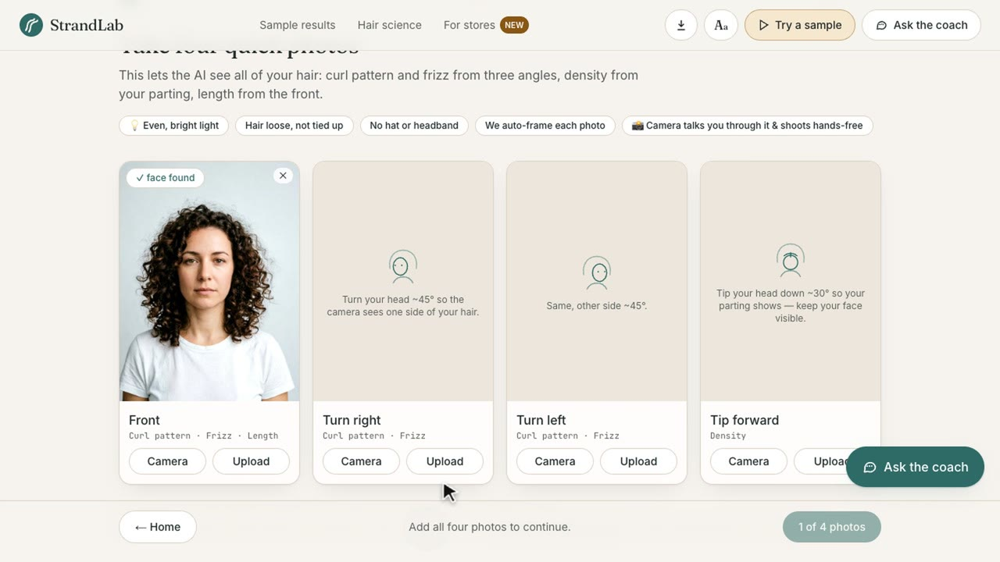
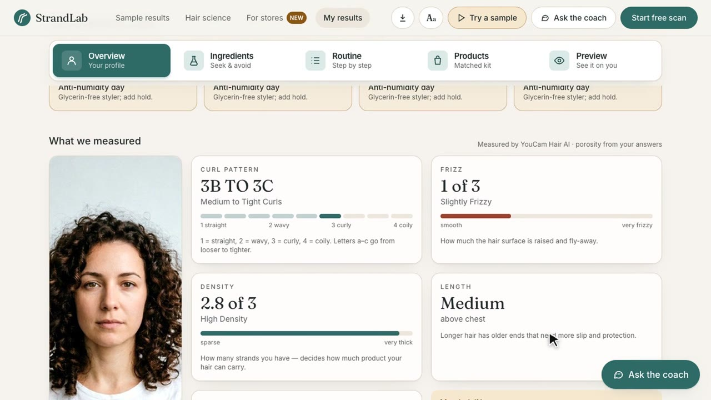
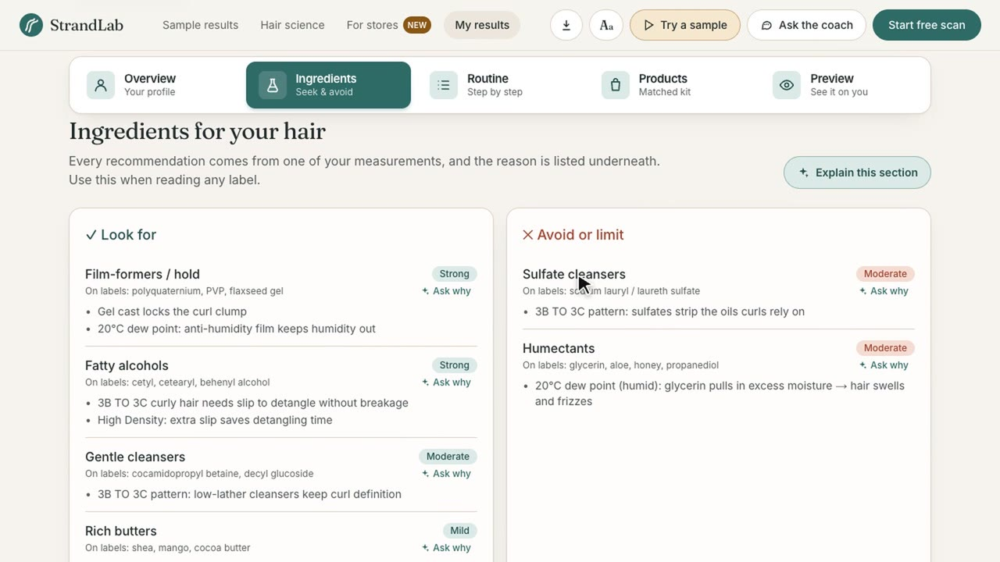
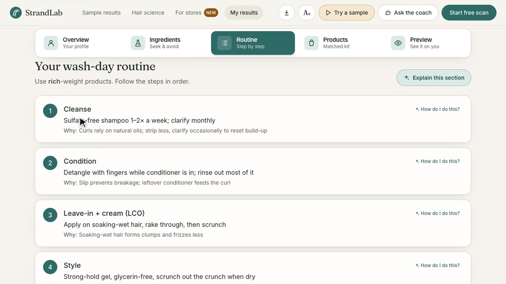
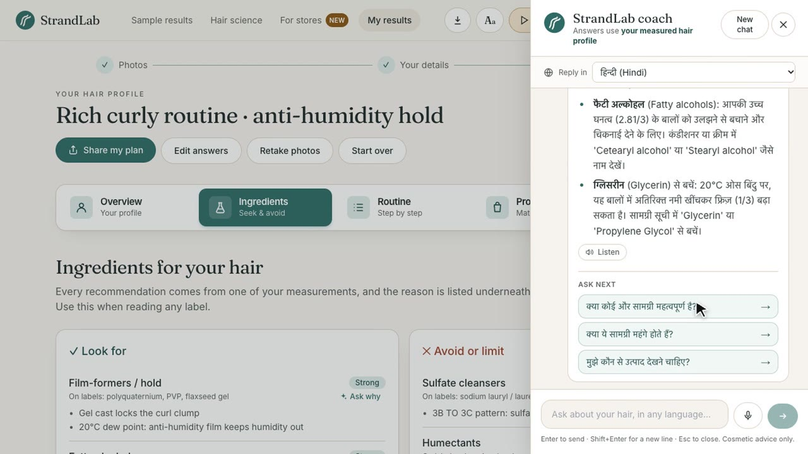
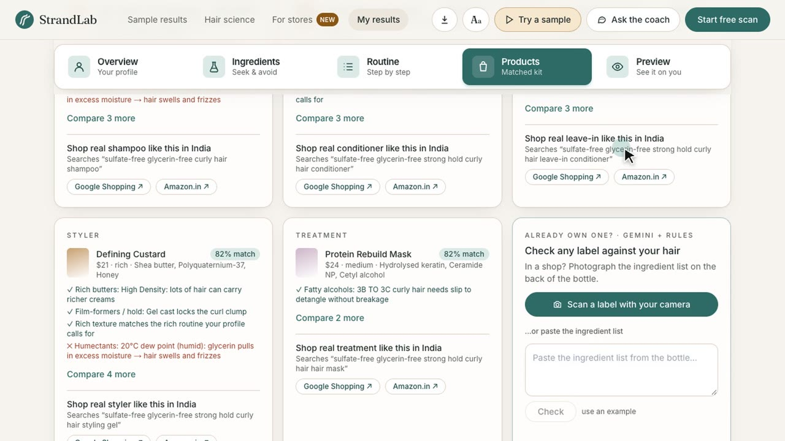
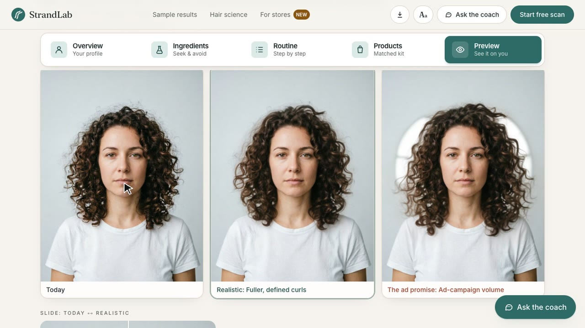
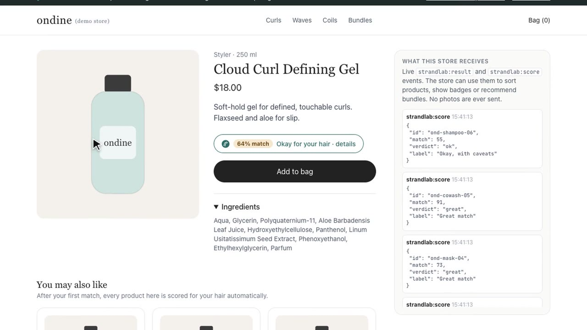
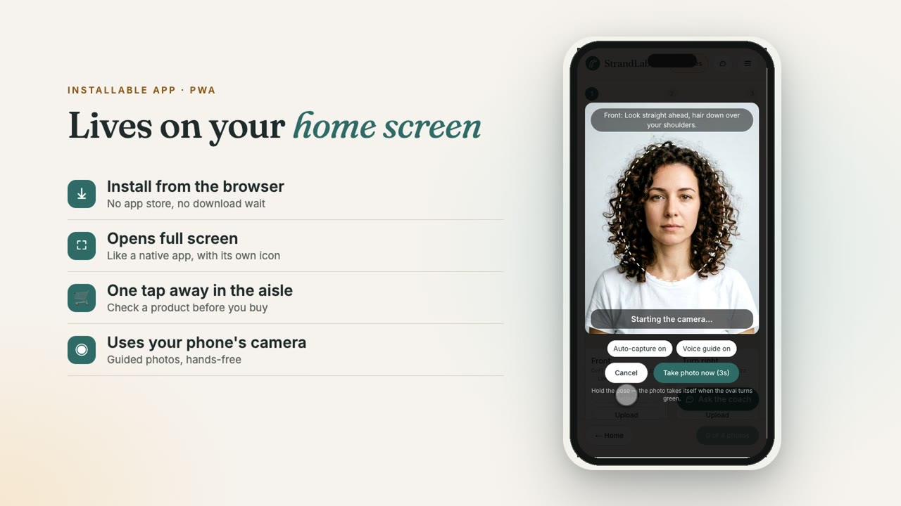
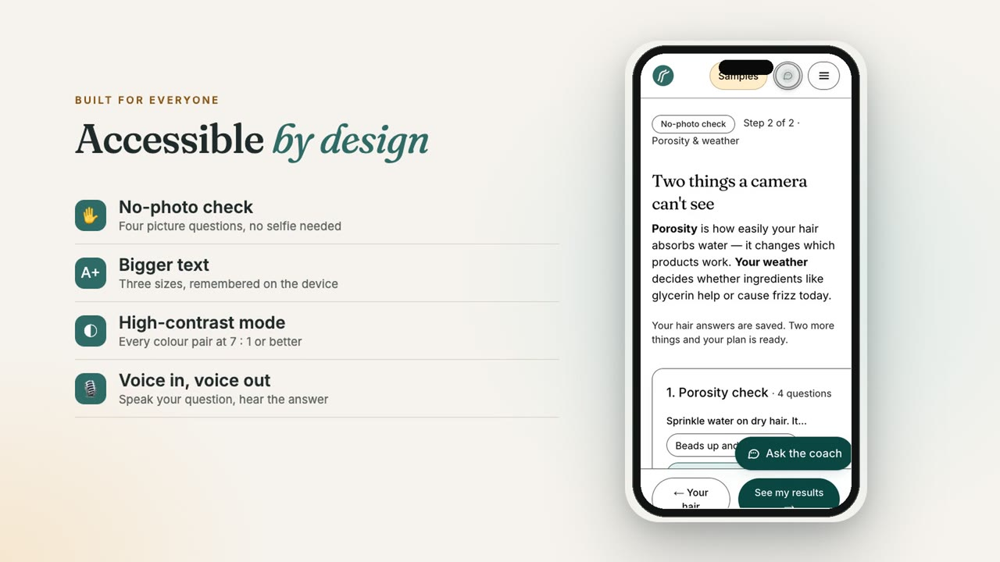

# StrandLab: your hair type, measured

**Your hair, measured by YouCam Hair AI, explained in plain words, and ready for any store.**

| | |
|---|---|
| 🎬 **Demo video (2:58)** | _YouTube link coming soon_ |
| 🌐 **Live app** | https://strandlab-youcam.vercel.app (no login, free, installable as an app on phones) |
| 🛍️ **Store widget demo** | https://strandlab-youcam.vercel.app/store-demo (a fictional shop where one `<script>` tag adds hair matching to every product) |
| ⚡ **No-photo try** | https://strandlab-youcam.vercel.app/samples (real YouCam results for three sample people) |
| 🧪 **Built for** | [YouCam API Skin AI & eCommerce Hackathon](https://youcam-api-skin-ai-ecommerce.devpost.com) |

**For curly, wavy, coily and frizz-prone shoppers who keep buying products that don't suit their hair.**

<table>
<tr>
<td width="50%"><br><sub><b>Scan:</b> four guided photos, auto-framed for YouCam</sub></td>
<td width="50%"><br><sub><b>Measured:</b> curl pattern, frizz, density and length from YouCam Hair AI</sub></td>
</tr>
<tr>
<td><br><sub><b>Ingredients:</b> look for and avoid, each with the measurement behind it</sub></td>
<td><br><sub><b>Routine:</b> four wash-day steps, each with its reason</sub></td>
</tr>
<tr>
<td><br><sub><b>Coach:</b> grounded in your measurements, in 17 languages, by voice</sub></td>
<td><br><sub><b>Shop:</b> a ranked kit, localised real-product search, and a label photo check</sub></td>
</tr>
<tr>
<td><br><sub><b>Preview:</b> a YouCam Hair Volume try-on, realistic result vs the ad promise</sub></td>
<td><br><sub><b>Any store:</b> one script tag adds match badges, and the store gets the result as an event</sub></td>
</tr>
<tr>
<td><br><sub><b>PWA:</b> installs from the browser, full screen, with an offline page</sub></td>
<td><br><sub><b>Accessible:</b> a no-photo route, bigger text, high contrast, voice in and out</sub></td>
</tr>
</table>

## Try it in 60 seconds (for judges)

1. Open https://strandlab-youcam.vercel.app/samples and pick **Maya**. These are real YouCam measurements, with no photos needed. Browse the tabs: **Overview · Ingredients · Routine · Products · Preview**.
2. Click **Ask the coach**, set "Reply in" to **हिन्दी**, and ask anything. Try the mic.
3. Open https://strandlab-youcam.vercel.app/store-demo, tap **Find my hair match**, pick Maya and tap **Done**. Every product now shows a match badge, and the right-hand panel shows what the store's code receives.
4. On a phone, use **Start free scan** for the full camera flow (about 30 s of analysis), or open the menu and tap **Install app**.

**Target devices:** desktop browsers (Chrome, Edge, Safari, Firefox), and phones (Android Chrome and iOS Safari) both in the browser and installed as a PWA. The demo video shows both.

---

## The problem

Hair-care labels say "for 3B curls", "for fine hair" or "for high porosity". Most shoppers have no idea which of those they are, so they guess. They buy a product, it doesn't work, they buy another, and the shelf fills with half-used bottles. The weather makes it worse: the same glycerin gel defines curls on a mild day and causes frizz on a humid one. Skin care has diagnostics. Hair care, especially for curly, wavy and coily hair, mostly has guesswork.

## The solution

StrandLab measures what people currently guess, then turns it into shopping decisions:

1. **Measures** your hair with four YouCam Hair AI detectors.
2. **Adds** the two things a camera can't see: porosity (a 4-question quiz) and the dew point at your location (live forecast).
3. **Explains** which ingredient families to look for or avoid. Each recommendation names the measurement behind it.
4. **Shops** for you with ranked products, a checker for any label you paste, and a realistic try-on next to the "ad promise".
5. **Plugs into any online store:** one script tag adds a "Find my hair match" button to a shop's product pages. Every product then shows a match badge for the shopper, and the store receives the result as a JavaScript event ([details](#for-stores-one-script-tag-puts-strandlab-on-any-product-page)).

> Try it in 10 seconds without photos: https://strandlab-youcam.vercel.app/samples (one click from the header **Try a sample** button or the hero). AI-generated people, real YouCam measurements.

---

## How StrandLab meets the judging criteria

### 1. Technological implementation: six YouCam APIs, chained

| YouCam API | Input | What StrandLab does with the output |
|---|---|---|
| **Hair Type Detection** | front + right + left | Curl family (straight → coily). Drives product weight, slip and hold rules, **and selects which try-on API and template to run** |
| **Hair Frizziness Detection** | the same 3 angles | Frizz 0–3. Drives the film-former, drying-alcohol and cleanser rules. Re-scans track whether frizz drops |
| **Hair Density Detection** | head-tipped-forward photo | Density 0–3. Decides whether hair can carry butters and oils |
| **Hair Length Detection** | front photo | Adds slip and end-care rules for long hair |
| **Hair Volume VTO** | front photo + template | "Realistic with this routine" vs "ad promise" preview |
| **Wavy Hair VTO** | front photo + template | The same comparison for wavy patterns |

Engineering details:

- **Auto-framing retry ladder** (`src/lib/diagnose.ts`, `src/lib/frame.ts`):
  - **What the detectors reject:** faces outside 50–80% of the image width (`error_face_position_too_small` / `…out_of_boundary`), sets of photos with different pixel sizes (`error_mismatch_image_size`), and framing-sensitive angles.
  - **How StrandLab handles it:** the browser computes a face box with MediaPipe. The server then crops, pads and resizes with sharp, and walks tighter or looser framings until YouCam accepts. Rejected tasks aren't billed, so the retries cost nothing.
- **Parallel, traced analysis.** The browser fires three requests at once (curl+frizz, length, density). Each gets its own serverless time budget, and the UI shows live progress. Every YouCam attempt is recorded and shown in **"How we measured this"**: the API, the photos used, each framing tried, the outcome and the time taken.
- **Caching.** Results are cached by image hash, so repeat runs spend no units.
- **Graceful degradation.** If Gemini is rate-limited, the label checker falls back to the deterministic INCI classifier, and the coach answers from the rule engine's own output instead of showing an error.
- **An explainable rule engine** (`src/lib/rules.ts`) scores 14 ingredient families. Every score carries its reasons. **Unit tests:** `npm test` runs 19 Vitest tests covering the rule engine, scoring and the INCI classifier.
- **Gemini** is used in two places. It maps a pasted INCI ingredient list to the rule-engine families, and the scoring itself stays deterministic. It also powers a coach that is grounded in the measured profile, returns follow-up questions, and offers per-section "Explain this" and per-item "Ask why" buttons. Requests rotate across API keys with failover.

### 2. Design: a complete product, not a proof of concept

- **Full product flow:** a landing page that explains the product, a guided 3-step scan (progress stepper, Back/Next on every step, camera with a framing guide or upload), and tabbed results (Overview · Ingredients · Routine · Products · Preview).
- **Coach:** a slide-over coach is available on every page.
- **Installable app (PWA):** manifest, maskable icons, service worker, offline page and install prompt. Shoppers can install it from the browser with no app store, open it full screen from the home screen in the store aisle, use the phone camera for the guided scan and label photos, and reopen pages they've already visited (such as their results) on a bad shop signal. Other pages fall back to an offline screen.
- **Accessibility:** skip link, ARIA tabs and dialogs, visible focus, scroll padding so focus is never hidden behind sticky bars, reduced-motion support, and layouts that work from phone to desktop.

### For stores: one script tag puts StrandLab on any product page

```html
<script src="https://strandlab-youcam.vercel.app/widget.js" async></script>
<div data-strandlab data-product="Curl Gel" data-product-id="sku-123"
     data-ingredients="Aqua, Glycerin, Polyquaternium-11, …"></div>
```

- **Live demo store:** https://strandlab-youcam.vercel.app/store-demo (a fictional shop). **Docs:** `/for-stores`.
- **For the shopper:**
  - Tapping the button opens StrandLab in an isolated iframe dialog, so they never leave the store.
  - They match once: a quick 5-question check, a sample, or their own YouCam-measured scan. The scan is shared from a first-party pop-up only after they tap **Share**.
  - The button then shows e.g. **"82% match · suits your hair"**, and every other product button on the page gets its own badge automatically.
- **For the store:** its code receives a `strandlab:result` event with the match, reasons, profile summary and `lookFor`/`avoid` lists, plus `strandlab:score` events for each product. Photos never reach the store.
- **Engineering:**
  - `public/widget.js` is about 10 KB with no dependencies, and the button styles sit in Shadow DOM so the store's CSS can't break them.
  - Every `postMessage` is checked against the origin it came from.
  - Products are scored in the browser by a deterministic INCI classifier (`src/lib/inci.ts`, unit-tested), so badges cost nothing per page view and never hit an AI rate limit.

### Reach and accessibility: built for a wide audience

| Barrier | What StrandLab does |
|---|---|
| Doing the tipped-forward photo alone | **Guided camera:** live MediaPipe face keypoints check distance, centring, head turn, head tip and lighting. It **speaks** corrections and **auto-captures** when the pose holds steady |
| Not wanting to share selfies (privacy, no camera, head covering) | **No-photo check** (`/quick`): 4 picture-based questions build a self-reported plan, clearly labelled as lower confidence |
| Typing an INCI list in a shop | **Photograph the label:** Gemini reads the ingredient list from the bottle photo, and the rules score it |
| Language | The coach replies in **17 languages**, or auto-matches the language you type or speak |
| Low vision, dyslexia, low literacy, wet hands | **Voice in** (mic: recorded in the browser and transcribed by Gemini, so it works in every modern browser) and **voice out** ("Listen") in the coach. **Text size** (3 steps) and **high-contrast** mode, remembered per device |
| Shopping outside the US | Real-product links use your country's Google Shopping region and Amazon store |
| Getting advice to a stylist or friend | **Share my plan** via the phone share sheet, WhatsApp or email |

**Audited:** axe-core reports 0 WCAG 2.1 A/AA violations on every page in default and high-contrast modes, including the results tabs, the coach, the scan flow and the no-photo route.

### 3. Potential impact: a real audience and a measurable outcome

- **The problem:** curl type, porosity and climate change which ingredients work, and shoppers can't see any of them. The result is wasted purchases and abandoned routines.
- **What StrandLab does about it:**
  - **Ingredient guidance:** gives a specific "look for / avoid" list to take into any shop.
  - **Weekly routine:** plans each day of the week from the forecast dew point (e.g. "Thursday: anti-humidity day, glycerin-free gel").
  - **Label checker:** checks a product you already own before you buy another.
  - **Real-product search:** builds a shopping query from the rules for each category (e.g. "glycerin-free strong hold curly hair styling gel").
  - **Expectation setting:** shows the realistic result next to the ad promise, so people don't abandon a routine that is working.
  - **Proof it works:** a re-scan loop (with a calendar reminder) compares frizz and density over time, stored only on your device.

### 4. Quality of the idea: non-obvious API use and domain understanding

- Almost every hackathon hair entry uses colour, wig or hairstyle try-on. StrandLab uses YouCam's **hair diagnostics** for **care shopping**, mirroring the Skin AI brief for a neglected category.
- **Frizz detection × dew point** is the core insight: the same glycerin gel defines curls on a mild day and causes frizz on a humid or freezing one.
- **Hair science page** (`/learn`): explains every measurement, porosity, the dew-point thresholds, all 14 ingredient families and the full rule table.

---

## Run it locally

```bash
npm install
cp .env.example .env.local   # YOUCAM_API_KEY, YOUCAM_BASE_URL, GEMINI_API_KEYS (comma-separated), GEMINI_MODEL
npm run dev                  # http://localhost:3000
npm test                     # rule-engine and scoring unit tests
```

`scripts/build_samples.py` rebuilds the three sample profiles through the live API (dev server on :3100).

## Demo video

The 2:58 demo is generated entirely from code in `videos/`, so it can be rebuilt after any UI change. [The full script with timings](docs/VIDEO_SCRIPT.md).

```bash
cd videos && npm install
set -a; . work/.env; set +a         # SARVAM_API_KEY (voice-over)
python3 tts.py                      # narration.json → per-sentence voice-over + script/timeline.json
node scenes.mjs                     # drives the live site in Chrome and records each scene, timed to the voice
node captions.mjs                   # subtitles snapped to real pauses in the speech (+ .srt)
python3 music.py 178                # original background music, synthesised in code (no copyrighted audio)
python3 assemble.py                 # frame-locked mix → out/StrandLab_demo.mp4 (+ a no-subtitles version and an .srt)
```

## Project map

| Path | What it is |
|---|---|
| `src/lib/youcam.ts` | YouCam v2 client (upload → task → poll), all hair APIs |
| `src/lib/diagnose.ts` | Detector orchestration, auto-framing ladder, call trace |
| `src/lib/frame.ts` | sharp crops, padding and normalisation |
| `src/lib/rules.ts` | Rule engine, try-on plan, daily advice |
| `src/lib/catalog.ts` | Demo catalogue, scoring, real-product search query |
| `src/app/api/*` | `analyze` · `preview` (VTO) · `label` (Gemini) · `coach` (Gemini) |
| `src/components/*` | Scan flow, results tabs, coach, trace panel, insights |
| `public/widget.js` | Embeddable store widget (Shadow DOM button + iframe dialog) |
| `tests/` | Vitest unit tests |
| `videos/` | The pipeline that builds the demo video: scripted screen capture of the live site (Puppeteer), Sarvam AI voice-over, subtitles synced to the speech, original synthesised music, and an ffmpeg assembly step (see `videos/script/narration.json`) |

## Stack

Next.js 14 (App Router) · TypeScript · Tailwind · sharp · MediaPipe Tasks · YouCam API v2 · Gemini · Open-Meteo · Vercel.

## Notes

- **Product catalogue:** the ranked products are fictional and only show how matching works. The real-product search and the label checker work with any real product.
- **Sample people:** they are AI-generated with YouCam's image generator. Their measurements are real YouCam results.
- **Advice:** StrandLab gives cosmetic guidance only. For hair loss, scalp pain or sudden shedding, see a dermatologist.

MIT licensed, see [LICENSE](LICENSE).
